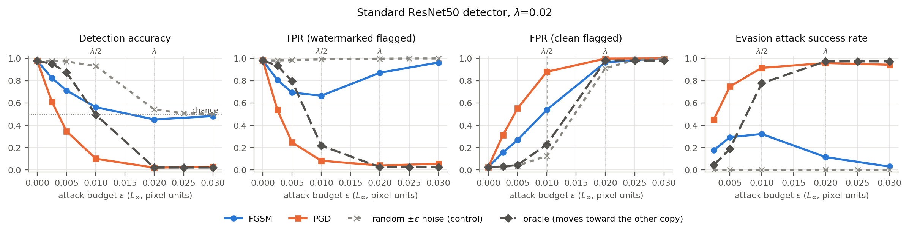
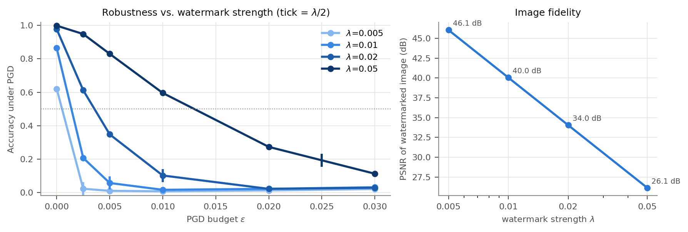

# Robustness of Vision Watermark Detection Against Adversarial Attacks

**DSC 261 · Fall 2026** — Emily Cheng, Seongho Kim, Paul Lai, Kevin Lin, Samantha Lin, Ariel Wang

We hide an invisible watermark in CIFAR-10 images, train a ResNet50 to detect it, and then try to
fool the detector with adversarial attacks (FGSM, PGD). We also test whether adversarial training
helps, and how watermark strength trades off against image quality.

📄 **[Read the report](report/main.pdf)** · 📓 **[Open the notebook](final.ipynb)**

---

## Key findings

| | Question | Answer |
|---|---|---|
| **H1** | Does detection get worse as the attack gets stronger? | **Yes.** 97.7% accuracy without attack → 34.7% under a PGD change of only ~1.3/255 per pixel. |
| **H2** | Is PGD stronger than FGSM? | **Yes**, for all 8 detectors (40 of 40 comparisons). |
| **H3** | Does adversarial training help? | **Yes, up to a limit.** PGD training cuts the attack's success from 74.9% to 7.7%, at a cost of 3.5 points of clean accuracy. |
| **H4** | Is a stronger watermark more robust? | **Yes, but it becomes visible.** Robust accuracy rises from 0.9% to 83%, while PSNR falls from 46 dB to 26 dB. |

Three things we did not expect:

- **There is a hard limit.** If the attacker may change each pixel by at least half the watermark's
  strength (ε ≥ λ/2), *no* detector can be robust: the clean and the watermarked copy of an image can
  both be moved to the same point. We prove this in the report and confirm it experimentally
  (best accuracy any detector keeps: 49.9%).
- **The detector learned "noise = watermark".** Plain random noise as strong as the watermark, with
  no knowledge of the model, makes it flag 91% of clean images as watermarked.
- **PGD alone overstates robustness.** Against the best adversarially trained detector, PGD removes
  only 12% of watermarks at ε = λ, but a stronger "oracle" attacker removes 91.5%.

<p align="center">
  
</p>
<p align="center">
  
</p>

---

## Where to start

| If you want to… | Open |
|---|---|
| Read the full write-up | [`report/main.pdf`](report/main.pdf) |
| See every table and figure with the code that makes it | [`final.ipynb`](final.ipynb) — runs in a few minutes, no GPU needed |
| Look at the raw numbers | [`runs/full/all_results.csv`](runs/full/all_results.csv) |
| Understand the method in code | [`wmrobust.py`](wmrobust.py) |

## Repository layout

```
├── final.ipynb              ← main notebook: loads results, reproduces all tables and figures
├── report/
│   ├── main.pdf             ← final report
│   ├── main.tex             LaTeX source
│   ├── figures/             figures (generated)
│   └── generated/           tables and numbers used in the text (generated)
├── wmrobust.py              core code: data, watermark, detector, attacks, training, evaluation
├── run_experiments.py       trains and evaluates all 8 detectors
├── controls.py              control experiments: random noise and the oracle attacker
├── make_report_assets.py    builds report/figures and report/generated from the results
├── dsmlp_job.sh             job script we used on UCSD DSMLP
├── runs/full/               results of the full run (CSV files, training logs)
├── proposal/                project proposal
├── main.ipynb               first exploratory notebook (baseline only)
└── main revised Sam.ipynb   revised exploratory notebook
```

## Reproduce

```bash
pip install -r requirements.txt
```

| Step | Command | Time |
|---|---|---|
| 1. Quick check | `python run_experiments.py --quick` | ~5 min on a GPU |
| 2. Full study | `python run_experiments.py --exp all` | ~1 h on one GPU |
| 3. Controls | `python controls.py --run runs/full` | ~3 min on a GPU |
| 4. Figures and tables | `python make_report_assets.py --run runs/full --dest report` | seconds |
| 5. Report PDF | `cd report && pdflatex main && bibtex main && pdflatex main && pdflatex main` | seconds |

- CIFAR-10 downloads automatically into `data/`.
- Step 2 is resumable: if it stops, run the same command again and it continues from the last epoch.
- Model checkpoints (~95 MB each) are not in the repo. Step 3 and the attack demo in the notebook need
  them, so run step 2 first.
- Our full run used one NVIDIA RTX PRO 6000 (MIG slice) on DSMLP and took 51 GPU-minutes.

## Experimental setup

| | |
|---|---|
| Data | CIFAR-10: 45,000 train / 5,000 validation / 10,000 test originals |
| Watermark | `x + λ·W`, clipped to [0, 1]; `W` is a fixed random ±1 pattern; main λ = 0.02 |
| Detector | ImageNet-pretrained ResNet50 with a 2-class head; SGD (lr 0.001, momentum 0.9), 10 epochs |
| Attacks | FGSM; PGD (10 steps, step ε/4, random start); ε from 0.0025 to 0.03 |
| Adversarial training | each batch = clean images + their FGSM or PGD versions; ε = 0.005 or 0.01 |
| Watermark strengths | λ = 0.005, 0.01, 0.02, 0.05 |
| Test set | paired: every test image is scored both clean and watermarked (20,000 images) |

## AI usage

The proposal was edited with help from ChatGPT, and parts of the exploratory notebooks were written
with ChatGPT. The final code and notebook were written with help from Claude (Anthropic) and
reviewed by the team.
